# horwitz keymap for the Lemokey X4

A Windows layout and a Mac layout in one firmware, with the keyboard choosing between them. Build target:
`keychron/x4/ansi_encoder/red`, keymap `horwitz`.

## Modes

The keyboard is always in one of two **modes**. They differ only in the bottom row (and in three Fn keys, below).

| Bottom-row key | Windows mode | Mac mode |
|---|---|---|
| Right of Left Ctrl | Windows key | Option |
| Left of the space bar | Alt | Command |
| Right of the space bar | Alt | Command |

Everything else, including the F-row and the encoder, is the same in both.

| Layer | Number | Used in |
|---|---|---|
| `WIN_BASE` | 0 | Windows mode |
| `WIN_FN` | 1 | Windows mode, while Fn is held |
| `MAC_BASE` | 2 | Mac mode |
| `MAC_FN` | 3 | Mac mode, while Fn is held |

## The layers, as a picture

A key with a solid outline does something on that layer; a faded key is transparent (it does what the layer below does). The
Fn key is pink on the base layers. On the knob's key, the large label is what pressing it does and the small line under it
is what turning it does.

The picture is **generated**, so it does not follow the keymap by itself. After changing `keymap.c` or `keymaps.h`, regenerate
it by running `./tools/draw_layers.ps1` from this folder in PowerShell. It needs QMK MSYS and a Python from 3.12 to 3.14 (3.15
is not supported yet: one of the drawing tool's dependencies has no ready-made package for it). The script creates its own
environment outside the repository and, the first time, installs the drawing tool (`keymap-drawer`, pinned to one version,
from ready-made packages only). Two things in the picture are written by hand in `tools/polish_legends.py`: the modifier
names on the Mac layer (Option, Cmd) and what turning the knob does. The file lives in the `keymaps` folder, next to this one
and not inside it, because `qmk lint` rejects image files inside a keymap folder.

## Choosing the mode

- **Automatically.** Each time the keyboard is connected to a computer (or plugged in), it guesses the computer's
  operating system from how it talks over USB. A Windows computer gets Windows mode and a Mac gets Mac mode. This takes
  a fraction of a second.
- **By hand.** **Fn + `\`** selects Windows mode and **Fn + `/`** selects Mac mode. A manual choice wins until you unplug
  the keyboard or move it to a different kind of computer, and it is also saved in the keyboard's memory.
- **Sleep and wake keep your choice.** A computer often reconnects the keyboard when it wakes. If it is the same kind of
  computer as before, the keyboard leaves the mode alone, so a mode you chose by hand survives. (A different kind of
  computer, e.g., after a USB switch, is followed as usual.) The mode key may blink on a wake: that is the keyboard
  confirming the mode it is in.
- **The saved mode is the fallback.** When the guess does not give Windows or Mac (e.g., a Linux computer, or a power-only
  charger that never talks to the keyboard), the keyboard keeps the saved mode, which is the one you last chose by hand.
  The automatic choice is never saved, so it never overwrites your own.
- **The guess can be wrong.** It is a heuristic (QMK reports a Mac as "iOS", which this keymap treats as a Mac). If it
  gets it wrong, choose by hand.

Selecting Mac mode also turns off the Win lock (below), so Command can never be left disabled.

## Feedback

- **The blink.** The key of the active mode (`\` for Windows, `/` for Mac) pulses dark three times when you press a mode key
  and at every connection once the mode is settled, whether or not the mode changed. It works with the backlight on,
  dimmed or off.
- **The Fn display.** While Fn is held, only the keys that do something on the Fn layer are lit, at full brightness, and
  every other key is dark (with the backlight on, dimmed or off). Both mode keys are lit, and **the active mode's key
  breathes** (fades slowly), so the key that moves is the mode you are in. That is 26 keys in Windows mode and 25 in Mac
  mode. The display is read from the keymap, so a key added to a Fn layer lights up on its own.
- **Sleep.** The lighting turns off when the computer sleeps and comes back when it wakes.

## The Fn layer

Hold **Fn** and press:

| Key | Action |
|---|---|
| F1 / F2 | Screen brightness down / up |
| F3 | Windows: Task View (`Win+Tab`). Mac: Mission Control |
| F4 | Windows: File Explorer (`Win+E`). Mac: Launchpad |
| F5 / F6 | Backlight dimmer / brighter |
| F7 / F8 / F9 | Previous track / play-pause / next track |
| F10 / F11 / F12 | Mute / volume down / volume up |
| Tab | Backlight on/off |
| Q | Next lighting effect |
| W / S | Backlight brighter / dimmer |
| V | Types the firmware's identity into the focused window: `horwitz x4` and the git commit it was built from, e.g., `horwitz x4 1ca1dbfc19`. A `*` after the hash means it was built with uncommitted changes (a build from GitHub has no `*`). Use it in a text field to tell which build is on the keyboard |
| N | Switch between N-key rollover and 6-key mode. N-key rollover is the default: any number of keys can be held at once. Leave it on, and press this only if a BIOS, a boot menu or a KVM switch ignores the keyboard. The keyboard does not show which mode it is in; to check, hold seven ordinary keys (not Shift, Ctrl, Alt or Cmd) at once in an online key tester: if all seven show, N-key rollover is on |
| `\` | Windows mode |
| `/` | Mac mode |
| Arrow keys | Left: Home. Up: PgUp. Down: PgDn. Right: End (the X4 has no End key) |
| Del | End (a second way to it, for the same reason) |
| Left Win key (the one next to Left Ctrl) | Windows only: toggle the **Win lock**, which disables the Windows key (the lock LED stays lit while it is on); not available in Mac mode |
| Encoder: turn / press | Backlight brightness down / up; backlight on/off (without Fn: volume down / up; mute) |

## Building, flashing and debugging

On Windows these run in the **QMK MSYS** shell, which QMK's Windows installer provides (open it from the Start menu, then go
to the folder of this repository).

    qmk compile -kb keychron/x4/ansi_encoder/red -km horwitz
    qmk flash   -kb keychron/x4/ansi_encoder/red -km horwitz

To flash, put the board in its bootloader first: unplug it, hold **Esc**, and plug it in while holding. After a flash it
restarts by itself.

**Debug output** is built in only on request: add `-e DEBUG=1` to either command. That switches on the console, and the
keymap then prints a line for each mode key press and each automatic choice. Read it with `qmk console -t`, or in the
separate **HID Console** window of QMK Toolbox (on Windows the main log pane does not show it). A normal build has none of
this, and the DEBUG build is larger (about 74 KB against 68 KB). Flash a normal build again when you are done.

## A ready-made build

Every push to the repository's `x4` branch builds this keymap on GitHub and keeps the firmware for 30 days, so you can
get an image without a build setup. Open the repository's **Actions** tab on GitHub, pick a run of "horwitz keymap (X4)",
and download the artifact **horwitz-x4-firmware** from the bottom of the run's page: a zip holding
`keychron_x4_ansi_encoder_red_horwitz.bin`. (GitHub asks you to sign in to download it.) The run's summary page lists the
file's size and SHA-256, so you can check the download. Flash it with the board in its bootloader (see above), using any
tool that writes a `.bin` to address `0x08000000`, e.g., QMK Toolbox or `dfu-util`; this repository's own builds were
flashed with `qmk flash`.

## Files

| File | Purpose |
|---|---|
| `keymap.c` | The base layers and the encoder map |
| `keymaps.h` | The two Fn layers and the Windows shortcuts |
| `layers.h` | The layer numbers |
| `ctrlkeycodes.h` | The custom keycodes: choosing the mode, and typing the firmware's identity |
| `horwitz.c` | The behavior: choosing the mode, the Win-lock release, the blink, and the Fn display |
| `tools/` | The scripts that regenerate the picture of the layers (`../horwitz_layers.svg`): `draw_layers.ps1`, its settings and `polish_legends.py` |
| `rules.mk` | Build options (the encoder map, OS detection and the `DEBUG=1` switch) |

## License

GPL-2.0-or-later, like the rest of the tree. `keymap.c` and `keymaps.h` are derived from Keychron's stock `default`
keymap and keep Keychron's notice, with a line for the modifications; the other source files carry an SPDX header.

There is no VIA/Launcher support on purpose: the keymap in the repository is the only source of truth, and it changes by
reflashing.
